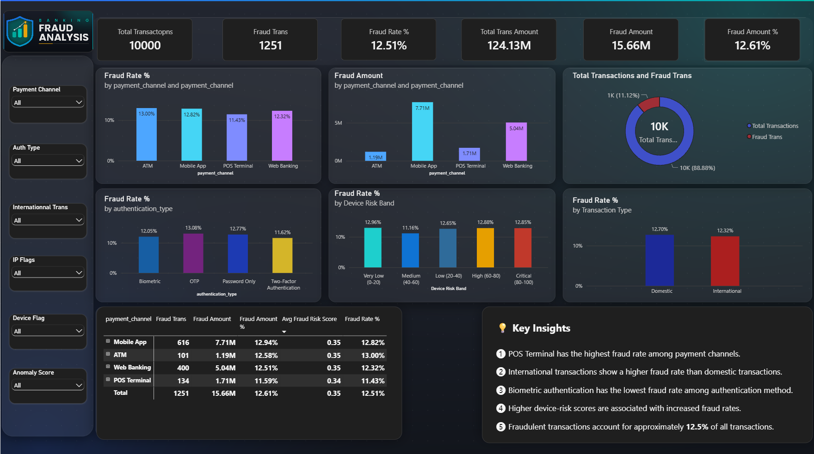

# Banking Fraud Analysis Dashboard | Power BI

An interactive **Banking Fraud Analysis Dashboard** built in Microsoft Power BI to explore transaction volumes, fraud rates, fraud amounts, payment channels, authentication methods, device-risk bands, and domestic versus international transactions.

> **Project type:** Data Analytics / Fraud Analytics  
> **Tool:** Microsoft Power BI  
> **Domain:** Banking, Payments, Fraud Risk  
> **Dataset size shown in dashboard:** 10,000 transactions

## Dashboard Preview

## Business Problem

Banks and payment providers need to understand where fraudulent transactions occur, how much money is exposed, and which transaction characteristics deserve further investigation. This dashboard brings key fraud indicators together so analysts and risk teams can explore patterns and prioritize deeper analysis.

## Objectives

- Monitor total transaction volume and fraud volume.
- Measure the overall fraud rate and the share of transaction value associated with fraud.
- Compare fraud patterns across payment channels and authentication methods.
- Examine fraud rates across device-risk bands and transaction types.
- Provide interactive filters for investigating subsets of transactions.
- Turn dashboard findings into follow-up questions for fraud operations and risk teams.

## Key Performance Indicators (KPIs)

| KPI | Value shown | Meaning |
|---|---:|---|
| Total Transactions | 10,000 | All transactions represented in the dashboard |
| Fraud Transactions | 1,251 | Transactions classified as fraudulent |
| Fraud Rate | 12.51% | Fraud transactions divided by total transactions |
| Total Transaction Amount | 124.13M | Total value of transactions; currency is not specified in the screenshot |
| Fraud Amount | 15.66M | Value associated with fraudulent transactions |
| Fraud Amount % | 12.61% | Fraud amount divided by total transaction amount |

**Metric definitions**

- **Fraud Rate (%)** = Fraud Transactions ÷ Total Transactions × 100
- **Fraud Amount (%)** = Fraud Amount ÷ Total Transaction Amount × 100

The currency unit for the amount fields is not visible in the screenshot, so this README uses **M** to mean million without assuming a currency.

## Dashboard Features

### Interactive filters
- Payment Channel
- Authentication Type
- International Transaction
- IP Flags (Internet Protocol flags)
- Device Flag
- Anomaly Score

### Visuals
- Fraud rate by payment channel
- Fraud amount by payment channel
- Total transactions versus fraud transactions
- Fraud rate by authentication type
- Fraud rate by device-risk band
- Fraud rate by transaction type
- Summary table by payment channel
- Key-insights panel

## Business Questions and Answers

The answers below are based on the values visible in the supplied dashboard screenshot. They should be rechecked against the underlying Power BI model before being used for business decisions.

### 1. What proportion of transactions are fraudulent?
**Answer:** The dashboard shows **1,251 fraudulent transactions out of 10,000 total transactions**, giving an overall fraud rate of **12.51%**.

**Business action:** Monitor this rate over time and compare it with historical baselines, fraud definitions, and business targets.

### 2. What share of total transaction value is associated with fraud?
**Answer:** The dashboard shows **15.66M** in fraud amount out of **124.13M** in total transaction amount. The displayed fraud-amount share is **12.61%**.

**Business action:** Track both fraud count and fraud value. A small number of high-value fraud cases can have a disproportionate financial impact.

### 3. Which payment channel has the highest fraud rate in the chart?
**Answer:** The chart labels show **ATM (Automated Teller Machine) at 13.00%**, followed by Mobile App at 12.82%, Web Banking at 12.32%, and POS Terminal (Point of Sale Terminal) at 11.43%.

**Business action:** ATM transactions are the highest-rate channel in this chart, so investigate ATM-specific transaction patterns, authentication, locations, and controls. Confirm that the rate is calculated consistently across channels before prioritizing controls.

### 4. Which payment channel has the largest fraud amount?
**Answer:** The fraud-amount chart shows **Mobile App at 7.71M**, followed by Web Banking at 5.04M, POS Terminal at 1.71M, and ATM at 1.19M.

**Business action:** Mobile App represents the largest fraud amount in the displayed breakdown. Review its transaction volume, customer journeys, device signals, and fraud-prevention controls. Compare absolute fraud amount with fraud rate before making decisions.

### 5. Which authentication method has the highest fraud rate?
**Answer:** **OTP (One-Time Password) is highest at 13.08%** in the chart. Password Only is 12.77%, Biometric is 12.05%, and Two-Factor Authentication is 11.62%.

**Business action:** Review OTP-related fraud scenarios, such as social engineering and account takeover, while checking the actual authentication flow and the number of transactions in each group. These figures alone do not prove that an authentication method causes fraud.

### 6. Which authentication method has the lowest fraud rate?
**Answer:** **Two-Factor Authentication is lowest at 11.62%** in the displayed chart, not Biometric authentication.

**Business action:** Validate the result using transaction counts, confidence intervals, and comparable customer/transaction groups before treating it as evidence that one method is more effective.

### 7. Do higher device-risk bands consistently have higher fraud rates?
**Answer:** **Not consistently in the displayed chart.** Very Low is 12.96%, Medium is 11.16%, Low (20–40) is 12.65%, High (60–80) is 12.88%, and Critical (80–100) is 12.85%. The Medium band is lower, and the Critical band is slightly below High.

**Business action:** Check how device-risk bands are defined and whether they have enough transactions. Analyze fraud counts and rates together, and investigate why the Very Low band has a relatively high displayed rate.

### 8. Is the international transaction fraud rate higher than the domestic rate?
**Answer:** **No—not according to the chart shown.** Domestic transactions are labelled 12.70%, while International transactions are labelled 12.32%.

**Business action:** Do not conclude that international transactions are riskier from this visual alone. Compare transaction counts, fraud amounts, customer mix, and other risk factors; also verify the chart’s underlying measures.

### 9. Which channel contributes the most fraudulent transactions?
**Answer:** The table shows **Mobile App with 616 fraud transactions**, followed by Web Banking with 400, POS Terminal with 134, and ATM with 101.

**Business action:** Prioritize deeper analysis of the Mobile App channel by both fraud count and fraud amount. Its contribution should also be compared with its share of all transactions.

### 10. What should the fraud team investigate next?
**Answer:** Based on the visible breakdowns, useful next steps include:
- Investigate Mobile App due to its largest displayed fraud count and fraud amount.
- Review ATM because it has the highest displayed channel fraud rate.
- Analyze OTP transactions because they have the highest displayed authentication-method fraud rate.
- Validate the device-risk and domestic/international comparisons.
- Add trend analysis by date/time, merchant or transaction type, customer segment, and geography if those fields are available.

## Important Data-Quality Check

Some statements in the screenshot’s **Key Insights** panel do not match the chart labels:

| Screenshot insight | What the charts show |
|---|---|
| POS Terminal has the highest fraud rate | ATM is highest: 13.00%; POS Terminal is 11.43% |
| International fraud rate is higher than domestic | Domestic is 12.70%; International is 12.32% |
| Biometric has the lowest authentication fraud rate | Two-Factor Authentication is lowest at 11.62%; Biometric is 12.05% |
| Higher device risk is associated with increasing fraud rates | The displayed rates do not rise consistently across bands |

The table and charts may also be using different measures or filter contexts: the table’s channel-level **Fraud Rate %** values do not all match the corresponding chart labels. Before publishing conclusions, verify the DAX measures, visual-level filters, relationships, and aggregation logic. The business answers above intentionally follow the chart labels where a chart-specific comparison is asked and call out the mismatch rather than treating it as confirmed truth.

## Suggested Technical Checks in Power BI

1. Confirm that `Fraud Rate %` is calculated as fraud transaction count divided by total transaction count in the current filter context.
2. Confirm that fraud flags are consistently encoded (for example, `1 = fraud`, `0 = non-fraud`) and that blanks are handled intentionally.
3. Check whether transaction IDs are unique; if not, use a distinct transaction count where appropriate.
4. Check whether amount measures use the same currency and aggregation rules.
5. Compare chart and table measures using the same fields, filters, and filter context.
6. Verify that slicers interact with all intended visuals.
7. Recalculate the Key Insights text after correcting the measures so it updates with filter selections.

## Acronyms and Short Forms

- **ATM** — Automated Teller Machine
- **POS** — Point of Sale
- **OTP** — One-Time Password
- **IP** — Internet Protocol
- **KPI** — Key Performance Indicator
- **DAX** — Data Analysis Expressions, the formula language used in Power BI
- **Power BI** — Microsoft’s business intelligence and data visualization platform
- **M** — Million (used for the amounts displayed in this dashboard)

## Tools and Skills Demonstrated

- Microsoft Power BI
- Data visualization and dashboard design
- Key Performance Indicator (KPI) reporting
- Fraud-rate and fraud-amount analysis
- Interactive filtering and drill-down exploration
- Business-question framing and data-quality validation
- Analytical storytelling and recommendations
